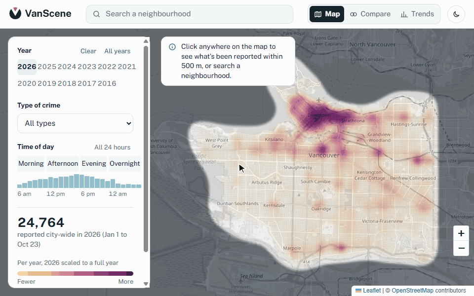

<h1>
  <picture>
    <source media="(prefers-color-scheme: dark)" srcset="docs/logo/vanscene-horizontal-reversed.svg">
    
  </picture>
</h1>

**See where and when crime is reported in Vancouver, in plain language.**

[](https://vanscene.netlify.app) [](https://youtu.be/DbSOYitXOZY) [](https://geodash.vpd.ca/opendata/)

<!-- GitHub shows the GIF that matches the reader's light or dark theme -->
<picture>
  <source media="(prefers-color-scheme: dark)" srcset="docs/vanscene-demo-dark.gif">
  
</picture>

VanScene turns the Vancouver Police Department's open crime data into a map you can read at a glance. It's for people choosing a neighbourhood or getting to know one: compare areas, see what kinds of incidents get reported there and at what time of day, and check whether a year was unusual.

**It shows reported incidents, not a safety rating.** Busy places show more because more people are there. Use it as one input next to visiting the area and talking to people who live there.

**Team:** Crimes Against Humanity · **Datathon:** Build Trilemma Datathon 2026

---

## What you can do

- **Read the map.** A heat map of reported incidents across the City of Vancouver, from pale amber for fewer to deep plum for more. The colour scale stays the same across years, so 2019 and 2025 can be compared directly.
- **Filter it.** Pick any years from 2016 on, a crime type (for example "Home break-ins" or "Bike theft"), and a time of day. The day is split into four equal six-hour parts, so they compare fairly. You can also click or drag across single hours on the chart under them.
- **Look at one spot.** Click anywhere for a summary of what was reported within 500 metres: how it compares with the city average for a circle that size, the most common types, when they happen, and year by year.
- **Search a neighbourhood** to jump straight to it.
- **Compare two areas.** Place A and B, and both are listed side by side: counts, change from the year before, and each area's top crime types with their share of its reports.
- **See the trend.** Trends shows the whole city year by year and hour by hour, with reports per day.
- **Share what you see.** The link keeps the view, years, crime type, hours and the spots you picked.
- **Use it your way.** It works on phones (the views sit in a bar at the bottom), with a keyboard, with a screen reader, and in light or dark mode.

## A one-minute walkthrough

You've just moved to Vancouver and you're choosing between two apartments, one in Mount Pleasant and one in Kitsilano.

1. Pick the years you care about, for example 2025 and 2026.
2. Drag across the evening hours on the time-of-day chart, if evenings are when you'll be out.
3. Click near the Mount Pleasant apartment to see what's been reported around it and how that compares with the city.
4. Open **Compare**, then click near the Kitsilano apartment. The two areas line up side by side.
5. Check **Trends** to see whether one year was unusual.

Instead of reading Reddit threads or asking about one area at a time, you see both places on the same data, with the source and its limits in the app.

## About the data

- **Source:** Vancouver Police Department, [GeoDASH Open Data](https://geodash.vpd.ca/opendata/).
- **What's in it:** about 375,000 mapped incidents from January 2016 to the latest weekly update. These are incidents police confirmed happened ("founded"), dated by when they occurred.
- **Kept up to date:** a GitHub Action refreshes it every Sunday after VPD republishes.
- **Where it's approximate:** VPD offsets every location for privacy. Property crime is moved to the hundred block, and offences against a person are spread across several blocks. That's why the map stops at street level and summaries use a 500 m circle.
- **What isn't on the map:** violent crime ("offence against a person" and homicide) has no location in VPD's data, so it can't be mapped. The app counts what's missing in **About this data**.

The full limitations are under [Responsible use](#responsible-use-and-disclaimer) and in the Datathon evidence at the bottom of this page.

## Run it locally

`web/data.json` is already in the repository, so you only need Python to serve the folder:

```
cd web
python -m http.server 8000
```

Then open `http://localhost:8000`. It needs a local server: opening `index.html` directly can't load the data.

### Refresh the data yourself

The weekly Action ([`.github/workflows/update-data.yml`](.github/workflows/update-data.yml)) runs every Sunday at 19:00 UTC: noon in Vancouver in summer, 11 am in winter. It downloads every year from 2016 to now, rebuilds `data.json`, and commits it only if something changed. To run it early, open the **Actions** tab, pick **Update crime data**, and click **Run workflow**.

To do the same on your own computer, from the project folder:

```
python scripts/update_data.py
```

It needs only standard Python, with nothing to install. It has three safeguards:

- **No new data:** it leaves `data.json` alone when VPD has nothing new.
- **A big drop:** it refuses to replace the file if the new data has more than 5% fewer incidents, which usually means a broken download. Add `--force` if the drop is real.
- **Bad text:** it stops if a crime type or neighbourhood name contains characters that could become web page markup.

To build from CSVs you downloaded yourself, unzip them into `data/raw/` and run `python scripts/prepare_data.py`. By using the data you agree to VPD's [disclaimer](data/vpd/legal_disclaimer.txt).

## How it's built

A static site with no framework and no build step. It's deployed on Netlify from the `web/` folder (see `netlify.toml`).

```
├── README.md
├── netlify.toml          # publishes web/ on Netlify
├── .github/workflows/
│   └── update-data.yml   # refreshes web/data.json every Sunday
├── data/
│   ├── raw/              # create locally for VPD CSVs (not in the repo)
│   └── vpd/              # VPD's disclaimer and data description
├── docs/
│   ├── logo/                   # the logo at the top of this page, light and dark
│   ├── vanscene-demo.gif       # the animation at the top of this page, light theme
│   └── vanscene-demo-dark.gif  # the same in the dark theme, shown to readers using GitHub's dark mode
├── scripts/
│   ├── update_data.py    # downloads the latest VPD data, then runs prepare_data.py
│   └── prepare_data.py   # turns the raw CSVs into web/data.json
└── web/
    ├── index.html        # the page
    ├── styles.css        # the look, light and dark
    ├── app.js            # the map, filters and panels
    └── data.json         # processed data the app loads
```

### Choices we made, and why

| Choice | Why |
|---|---|
| Plain HTML, CSS and JavaScript, no framework or build step | Easy to run, review and host, and anyone on the team can change it |
| Python standard library only for the data scripts | Teammates and mentors can run them without installing anything |
| Leaflet and Leaflet.heat on OpenStreetMap tiles | Free and open source, with no API keys or accounts |
| One fixed colour scale for every year and crime type | The same colour means the same amount everywhere, so years and types can be compared |
| Four equal six-hour parts of the day, compared per hour | Unequal periods made the longest one look busiest just because it was longer |
| Comparing an area with the city average for the same size of circle | A raw count alone says little; busy places will always show more |
| Map zoom capped at about street level, and a 500 m summary circle | VPD offsets locations, so building-level detail would imply precision the data doesn't have |
| Plain-language crime type labels (for example "Theft from cars" instead of "Theft from Vehicle") | Newcomers shouldn't need to learn police categories |
| Points stored column by column in `data.json` | The download is about 45% smaller, which matters most on phones |
| A weekly GitHub Action for the data | The map stays current without anyone remembering to update it |

## Contributing

Open an issue or a pull request against `main`. Keep changes small and focused, run the app locally to check them, and describe what changed and how you tested it in the pull request.

## What's next

- [ ] Add a feedback link and test with newcomers outside the team
- [ ] Check that testers don't read the map as a safety rating
- [ ] Add violent-crime counts to neighbourhood summaries (these rows have a neighbourhood but no map location)
- [ ] Explore adjusting counts for population or foot traffic, so busy areas aren't unfairly highlighted
- [ ] Note in the app that SkyTrain incidents are excluded (they're Transit Police jurisdiction)

## Responsible use and disclaimer

- **Not a safety rating.** VanScene shows where incidents were reported. It does not measure how safe an area is or predict future incidents.
- **Reported incidents only.** Many crimes go unreported, and reporting rates differ by crime type and community.
- **Approximate locations.** VPD offsets incident locations for privacy, and exact addresses are never shown. The 500-metre area is an estimate, not a precise boundary.
- **Violent crime isn't on the map.** VPD withholds locations for offences against a person, so the map shows property crime and traffic collisions only.
- **Counts, not rates.** Busy areas with more residents, workers, and visitors naturally show more reports. Figures are not adjusted for population or foot traffic.
- **Data limitations.** VPD open data can be delayed, revised, or reclassified. We can't guarantee figures are complete or current.
- **Responsible use.** Don't use VanScene to discriminate against people or communities, or as the sole basis for housing, rental, insurance, or employment decisions.

VanScene is an informational and educational project built for the Build Trilemma Datathon. It is not affiliated with, endorsed by, or operated by the Vancouver Police Department or the City of Vancouver. It is provided "as is," without warranties of any kind.

**Data source:** Vancouver Police Department, [GeoDASH Open Data](https://geodash.vpd.ca/opendata/).

**In an emergency, call 911.** VanScene is not an emergency or crime reporting service.

---

## Datathon evidence

Our Build Session 1 write-up for the Build Trilemma Datathon, kept as submitted. Click a section to open it.

<details>
<summary><b>Build Session 1: Problem evidence</b></summary>

### The problem is real

Moving to a new city means making a high-stakes housing decision about neighbourhoods you have never lived in. Crime is one of the first things newcomers want to know about, but the information available is either anecdotal (Reddit threads, friends' opinions, "don't live near X") or buried in raw police data that is hard to interpret.

**When it happens:** while browsing rental listings, comparing two neighbourhoods, or deciding whether to book a viewing.
**Why it happens:** there is no simple, transparent way to compare neighbourhoods on reported crime at a glance.

**Our N of 1:**

> When I moved to Vancouver in 2026, I spent days trying to figure out which area of Vancouver was safer to live in. I ended up relying on AI to tell me which areas were safer, asking about one area at a time, and it would give me an analysis based on indicators such as violent crime rate and car break-ins. I also checked a bunch of Reddit comments, which were helpful but not that reliable.

- [x] I experience this problem myself
- [x] I am the N of 1 user
- [x] I can clearly describe when and why the problem occurs
- [x] The problem is not hypothetical or invented for the Datathon

### Target users

| User | Need | Time window |
|---|---|---|
| Newcomers to Vancouver looking for housing (primary) | Compare neighbourhoods on reported crime as context while researching where to live | Long-term trends (months to years) |
| Residents interested in recent activity (secondary) | See what kinds of incidents have been reported in their neighbourhood recently | Recent months |

### The problem deserves a solution

A search returns opinions and news stories, not a comparison. Our N of 1 experience shows the limits of AI prompts: we had to ask about one area at a time, couldn't see neighbourhoods side by side, and couldn't tell where the numbers came from or how current they were. A prompt also can't reliably summarize hundreds of thousands of geolocated incidents or keep up with data that is refreshed weekly.

| Alternative | What it does well | What's missing for our users |
|---|---|---|
| VPD GeoDASH (official crime map) | Authoritative data, incident-level map, last 7 days by default | A dot map of individual incidents, not a comparison. Hard to answer "how does area A compare to area B?" Violent crime has no map location. |
| AI chat assistants | Fast, conversational answers | One area at a time, unclear sources, unknown freshness |
| Reddit / word of mouth | Local context and lived experience | Anecdotal, biased, outdated, inconsistent |
| Rental sites (Craigslist, Facebook Marketplace, etc.) | Listings | No crime information |
| News coverage | Context on major incidents | Skews toward dramatic events, not overall patterns |

**How VanScene is different**
- A heat map with area summaries, designed for comparison rather than browsing individual incidents
- Compare and Trends views that put areas and years side by side
- Ten years of data, so one unusual year doesn't define a neighbourhood
- The data source, date range, and limitations are shown in the app

- [x] The problem is complex enough that a single prompt or Google search does not already solve it
- [x] Solving it would create meaningful value
- [x] Existing tools do not already solve the problem just as well or better
- [x] I can explain what is missing from the current alternatives

### The scope is right

A microproduct: one web page, one dataset, one core interaction.

**Out of scope:** user accounts, real-time alerts, predictive "safety scores," address-level lookups, coverage beyond the City of Vancouver, combining with rental listing data.

- [x] The problem is narrow enough to make meaningful progress during the Datathon
- [x] The solution does not require building an entire platform or company
- [x] I can define what a useful first version looks like

</details>

<details>
<summary><b>Build Session 1: Data evidence</b></summary>

### Source

VPD GeoDASH Open Data: [geodash.vpd.ca/opendata](https://geodash.vpd.ca/opendata/)

Data is extracted from the PRIME BC Police Records Management System and filtered to comply with BC's Freedom of Information and Protection of Privacy Act (FIPPA). It counts "founded" incidents only, meaning police determined after investigation that the offence occurred. Dates reflect when the incident occurred, not when it was reported.

Fields: crime type, year/month/day/hour/minute, hundred block, neighbourhood, X/Y coordinates (UTM Zone 10, offset for privacy).

### Accessibility

- Downloadable as CSV from the GeoDASH open data page, covering incidents from 2003 onward
- Updated weekly (Sunday mornings), with up to a week's delay from VPD's internal system
- No API key or account needed
- We use data from 2016 to October 2, 2026

- [x] I know where the required data comes from
- [x] I can realistically access it during the Datathon
- [x] I have enough data to begin testing the idea

### Permission

No open data licence is published. Access requires accepting the GeoDASH disclaimer, and the site is marked "© City of Vancouver, all rights reserved." The disclaimer cautions users not to rely on the data to judge the safety of a specific location or area, and states that all locations are offset. VPD's disclaimer and data description are saved in `data/vpd/`.

We have not sought separate permission. We limit our use to:
- Non-commercial, educational use, attributed to the VPD
- The raw VPD CSVs are not committed to this repository. The app uses a processed file (`web/data.json`) derived from the public data, with VPD's privacy offsets preserved.
- Patterns, not safety verdicts. No safety scores or address-level lookups.
- We will contact the VPD before any commercial use.

- [x] I understand the licence or terms of use
- [x] I am allowed to use the data for my intended purpose (non-commercial, educational, within the limits above)
- [x] I understand whether the data can be used commercially, educationally, or only under specific restrictions (educational only; commercial use not confirmed)

### Signal

Initial exploration of 2026 data (January 1 to October 2, 2026):

| | Rows |
|---|---|
| Rows read | 25,092 |
| Mapped (have a location) | 22,997 (92%) |
| No location (withheld for privacy) | 2,094 |
| Outside Vancouver | 1 |

| Crime type | Incidents |
|---|---|
| Other theft | 11,353 |
| Theft from cars | 4,275 |
| Mischief and vandalism | 4,137 |
| Traffic collisions with injury | 900 |
| Business break-ins | 841 |
| Bike theft | 609 |
| Home break-ins | 580 |
| Car theft | 291 |
| Fatal traffic collisions | 11 |
| **Total** | **22,997** |

**Key finding:** violent crime can't be mapped, but it can be counted by neighbourhood. All 2,094 rows without a location are violent crime: 2,088 "Offence Against a Person" (robbery, assault, sexual assault, domestic assault) and 6 homicides. They have no coordinates, but every one has a neighbourhood value. So violent crime can't appear on the heat map, but it can be included in neighbourhood summaries.

### Known limitations and how we handle them

| Limitation | Impact | How we handle it |
|---|---|---|
| Violent crime has no map location | The heat map shows property crime and collisions only | Say so in the app; planned: neighbourhood-level violent crime counts |
| Property crime locations are generalized to the hundred block and offset | Block-level precision isn't possible or appropriate | Cap map zoom; summarize by area; state this in the app |
| "Offence Against a Person" is one broad category with no time | Can't break violent crime down by type or time of day | Show it as a single neighbourhood-level count when added |
| Only certain crime categories are included | Not a full picture of safety | Label as "reported incidents," never "safety" |
| Raw counts favour busy areas (Downtown has more residents, workers, and visitors) | The map may mislead newcomers and stigmatize neighbourhoods | Explain in the app; explore normalizing by population |
| SkyTrain crimes are excluded (Transit Police jurisdiction) | Gaps around transit stations | Note in the app |
| "All offence" counting | Totals aren't comparable to Statistics Canada figures | Don't compare against StatCan |
| Not real-time; data lags and classifications can change | Limits the "recent activity" use case | Show the data's last-updated date |
| Reported crime only | Under-reporting varies by crime type and area | Note in the app |

- [x] The data contains information relevant to the problem
- [x] I believe there is enough signal in the data to support a useful solution
- [x] I have enough coverage, quality, and volume to test that assumption

</details>
